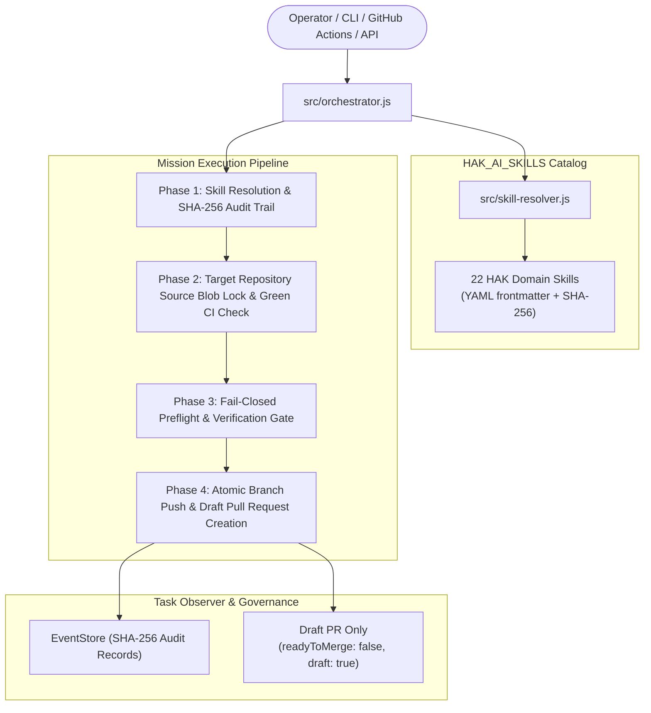

# HAK AI Agent Control Center: Skill-Driven Orchestrator Architecture

## 1. Overview
The Skill-Driven Mission Orchestrator coordinates autonomous code inspection, testing, patching, and verification across HAK ecosystem repositories (such as `HAK_VC_NB`), while pulling domain expertise, guidelines, and behavioral guardrails directly from the catalog in `HAK_AI_SKILLS`.



---

## 2. Core Principles & Governance Rules
1. **Active Skill Loading:** The Orchestrator proactively resolves, parses, and loads domain-specific skills (e.g. `hak-code-auditor`, `hak-data-integrity`, `hak-accounting-report`) based on mission type and changed file paths.
2. **Immutable Audit Trail:** All loaded skills have their SHA-256 hashes recorded and injected into Observer events.
3. **Fail-Closed Verification:** Patch proposals are never pushed to GitHub unless the repository's test suite and verification checks pass 100%.
4. **Draft PR Mode Strictly Enforced:** The Orchestrator never merges code directly to `main`. It exclusively creates Draft Pull Requests (`draft: true`, `requiresHumanReview: true`, `readyToMerge: false`).

---

## 3. Operator HTTP API Endpoints

### `GET /api/skills`
Lists all available skills from the local catalog and provides skill recommendations based on query parameters.
- **Query Params:**
  - `type`: Mission type (e.g. `bug`, `feature`, `security`, `audit`).
  - `description`: Textual summary of the task.
  - `files`: Comma-separated list of affected file paths.
- **Response:**
  ```json
  {
    "skills": [
      {
        "name": "hak-code-auditor",
        "description": "Standard HAK code review and static analysis",
        "sha256": "...",
        "bytes": 2048
      }
    ],
    "recommended": ["hak-code-auditor", "hak-data-integrity"]
  }
  ```

### `POST /api/operator/recommend-skills`
Recommends domain-appropriate HAK skills for a mission payload.
- **Headers:** `x-hak-operator-token: <session_token>`, `origin: http://127.0.0.1:<port>`
- **Request Body:**
  ```json
  {
    "type": "bug",
    "description": "Fix subcontract backup data loss and Excel m3 UOM header",
    "filePaths": ["app/main/services/BackupService.js", "app/main/reports/xlsxExport.js"]
  }
  ```
- **Response:**
  ```json
  {
    "recommended": [
      "hak-code-auditor",
      "hak-data-integrity",
      "hak-accounting-report"
    ]
  }
  ```

### `POST /api/operator/dispatch-mission`
Dispatches an end-to-end orchestrated mission against a target repository.
- **Headers:** `x-hak-operator-token: <session_token>`, `origin: http://127.0.0.1:<port>`
- **Request Body:**
  ```json
  {
    "mission": {
      "id": "MISSION_VC_NB_194",
      "targetRepo": "saoluucvhak-pixel/HAK_VC_NB",
      "title": "fix: subcontract backup and m3 Excel UOM",
      "type": "bug",
      "description": "Ensure subcontract files are packed and restored",
      "changes": [
        {
          "path": "app/main/services/BackupService.js",
          "patch": "...",
          "expectedBlobSha": "..."
        }
      ]
    },
    "authorizeDraftPr": true,
    "confirm": true
  }
  ```
- **Response:** `202 Accepted` with `{ "id": "MISSION_VC_NB_194", "status": "running" }`.

---

## 4. CLI Execution
Operators can invoke the mission runner directly via CLI:
```bash
node scripts/dispatch-mission.mjs \
  --spec path/to/mission-spec.json \
  --repo-dir D:/PROJECT_IT/VCNB_OFFLINE \
  --skills-dir ../HAK_AI_SKILLS \
  --authorize-draft-pr \
  --use-git-credential
```

---

## 5. Automated CI/CD
GitHub Actions workflow `.github/workflows/orchestrated-repo-mission.yml` enables running orchestrated missions directly in GitHub Actions with verifiable provenance and green build guarantees.
