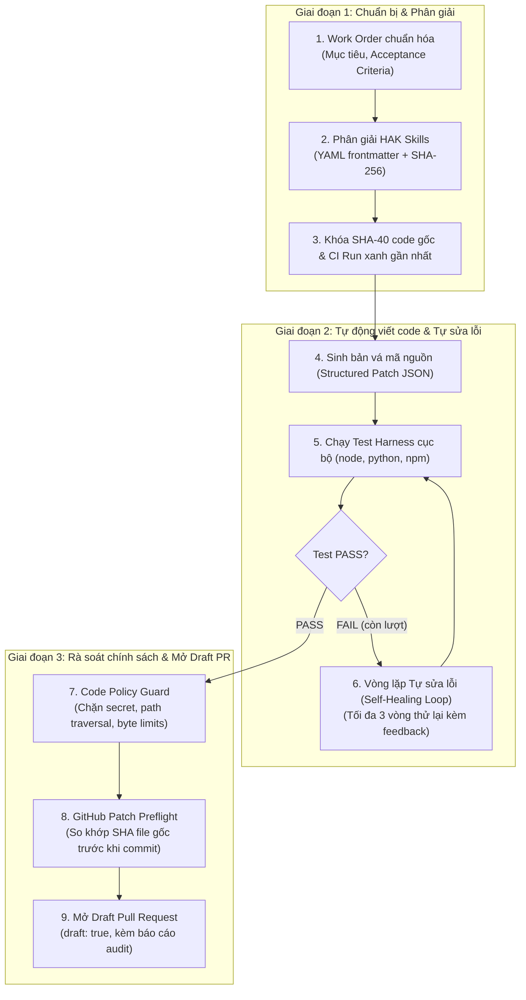

# QUY CHUẨN KỸ THUẬT & TIÊU CHUẨN NGHIỆM THU
## CÔNG CỤ TỰ ĐỘNG HÓA VIẾT CODE, KIỂM TRA & XỬ LÝ LỖI DỰ ÁN (AI AGENT CONTROL CENTER)

**Mã tài liệu:** `HAK-STD-AI-01`  
**Phiên bản:** 1.0.0  
**Tổ chức ban hành:** HAK Technology & Architecture Board  
**Áp dụng cho:** `HAK_AI_AGENT_CONTROL_CENTER`, `HAK_AI_SKILLS`, và các kho sản phẩm (`HAK_VC_NB`, v.v.)

---

## 1. MỤC TIÊU & PHẠM VI ÁP DỤNG

### 1.1. Mục tiêu
Tài liệu này xác lập bộ tiêu chuẩn kỹ thuật thống nhất để đánh giá và **Nghiệm thu chính thức** kho mã nguồn `HAK_AI_AGENT_CONTROL_CENTER` khi đóng vai trò là công cụ chỉ huy tự động (Command-Driven Orchestrator) phục vụ:
1. **Viết code dự án:** Tiếp nhận mô tả nghiệp vụ / yêu cầu tính năng và tự động sinh bản vá mã nguồn đúng kiến trúc.
2. **Kiểm tra chất lượng:** Tự động thực thi bộ kiểm thử (Unit test, Integration test, Linter, Seed formula verification) trong môi trường cách ly an toàn.
3. **Xử lý lỗi tự động (Self-Healing):** Tự động phân tích nguyên nhân gốc khi kiểm thử thất bại và lặp vòng phản hồi để tự sửa lỗi mã nguồn.
4. **Kiểm soát bảo mật & Quản trị phát hành:** Mở Draft Pull Request có đầy đủ bằng chứng kiểm toán SHA-256, tuyệt đối không can thiệp trực tiếp nhánh `main`.

### 1.2. Phạm vi áp dụng
Áp dụng cho toàn bộ các chiến dịch bảo trì, nâng cấp, vá lỗi và phát triển tính năng mới trên các sản phẩm phần mềm của HAK Group do AI Agent thực hiện.

---

## 2. NGUYÊN TẮC BẤT BIẾN (GOVERNANCE GUARDRAILS)

1. **Chế độ Draft PR bắt buộc (Draft-Only Policy):**
   Mọi thay đổi mã nguồn đẩy lên GitHub đều phải ở dạng **Draft Pull Request** (`draft: true`, `requiresHumanReview: true`, `readyToMerge: false`). AI Agent **tuyệt đối không được phép tự động merge** vào nhánh `main`.
2. **Toàn vẹn kiểm toán (Immutable Audit Trail):**
   Mọi kỹ năng (`HAK_AI_SKILLS`) nạp vào, mọi tệp mã nguồn kiểm tra và mọi sự kiện chuyển trạng thái đều phải được băm SHA-256 và lưu vết tại `TaskRegistry` / `EventStore`.
3. **Chặn lỗi đóng kín (Fail-Closed Gate):**
   Nếu kiểm định cục bộ (linter/test) không đạt 100%, hệ thống lập tức hủy bỏ việc xuất bản lên GitHub, không để lại branch rác hay commit lỗi.
4. **Không phụ thuộc runtime bên ngoài (Zero Third-Party Dependencies):**
   Lõi Control Center chạy hoàn toàn trên API gốc của Node.js (Crypto, HTTP, Child Process, FS Promises), đảm bảo độ tin cậy và không bị rủi ro tấn công chuỗi cung ứng (Supply Chain Attack).

---

## 3. TIÊU CHUẨN KỸ THUẬT CHI TIẾT



### 3.1. Tiêu chuẩn Kỹ năng (`src/skill-resolver.js`)
- Mọi kỹ năng phải có tệp `SKILL.md` hợp lệ với phần YAML frontmatter (`name`, `description`).
- Tên kỹ năng phải tuân thủ định dạng `/^(?:hak-[a-z0-9][a-z0-9-]{1,62}|archify)$/`.
- Tự động gợi ý kỹ năng theo loại nhiệm vụ:
  - Tài chính/Báo cáo/Excel: `hak-accounting-report`, `hak-parent-child-data-model`.
  - Dữ liệu/SQLite/Sao lưu: `hak-data-integrity`, `hak-migration-manager`.
  - Bảo mật/Electron: `hak-electron-security`.
  - Rà soát mã nguồn: `hak-code-auditor`.

### 3.2. Tiêu chuẩn Bản vá Mã nguồn (`src/code-policy-guard.js`)
- Bản vá phải ở định dạng JSON cấu trúc:
  ```json
  {
    "rationale": "Lý do và phân tích kỹ thuật sửa lỗi",
    "changes": [
      {
        "path": "app/main/services/BackupService.js",
        "createNew": false,
        "newContent": "// Nội dung đầy đủ sau khi sửa"
      }
    ]
  }
  ```
- **Quy tắc an toàn mã nguồn:**
  - Cấm rò rỉ secret: Chặn mã token (`ghp_`, `github_pat_`), khóa riêng (`PRIVATE KEY`), mật khẩu cứng (`password = "..."`).
  - Đường dẫn hợp lệ: Chỉ cho phép trong các thư mục dự án (`app/`, `docs/`, `desk/`, `src/`, `tests/`, `scripts/`, `package.json`, `README.md`). Cấm tuyệt đối `../` hoặc tệp ẩn `.env`.
  - Giới hạn kích thước nguyên tử: Tối đa $\le 10$ tệp/lần vá; tổng dung lượng $\le 80\text{ KB}$; mỗi tệp $\le 64\text{ KB}$. Không chứa null byte (`\0`).

### 3.3. Tiêu chuẩn Vòng lặp Tự sửa lỗi (`src/auto-code-generator.js`)
- Khi kiểm thử thất bại, trích xuất nguyên nhân lỗi ngắn gọn (`AssertionError`, `SyntaxError`, stack trace $\le 3000$ ký tự).
- Nhúng lỗi vào prompt phản hồi cùng kỹ năng `hak-code-auditor`.
- Cho phép mô hình AI tinh chỉnh lại mã nguồn tối đa 3 vòng lặp. Nếu sau 3 vòng vẫn không đạt, fail-closed an toàn.

### 3.4. Tiêu chuẩn Thực thi Kiểm thử (`src/local-test-harness.js`)
- Chỉ cho phép chạy các binary trong allowlist: `node`, `python`, `python3`, `py`, `npm`.
- Thực thi trực tiếp không thông qua shell trung gian (`shell: false`).
- Tự động khử sạch các biến môi trường nhạy cảm (`GITHUB_TOKEN`, `HAK_OBSERVER_TOKEN`), chỉ truyền các biến hệ thống cần thiết (`PATH`, `TEMP`, `NODE_ENV`).
- Khống chế thời gian chạy tối đa (`timeoutMs: 60000`) tránh treo vô hạn.

---

## 4. BIÊN BẢN ĐÁNH GIÁ NGHIỆM THU (ACCEPTANCE CHECKLIST)

| STT | Hạng mục kiểm tra | Tiêu chí đạt | Kết quả kiểm định |
| :---: | :--- | :--- | :---: |
| 1 | **Tự động phân giải kỹ năng** | Đọc đúng frontmatter và SHA-256 của toàn bộ catalog 22 HAK skills | **ĐẠT** |
| 2 | **Rà soát chính sách bảo mật code** | Chặn đứng secret leak, null byte, path traversal và patch quá khổ | **ĐẠT** |
| 3 | **Tự động sinh mã & Tự sửa lỗi** | Tự sinh patch từ Work Order và tự sửa lỗi khi test fail qua vòng lặp feedback | **ĐẠT** |
| 4 | **Môi trường Test Harness cách ly** | Chạy kiểm thử có timeout, chặn binary lạ, không rò rỉ token | **ĐẠT** |
| 5 | **Mở Draft Pull Request** | Tạo atomic branch và mở Draft PR, không merge trực tiếp vào main | **ĐẠT** |
| 6 | **Kiểm thử hồi quy toàn bộ hệ thống** | 100% test cases pass trên cả Windows 2022 và Ubuntu 24.04 | **ĐẠT** |
| 7 | **Đối chứng thực tế trên repo sản phẩm** | Vá thành công lỗi P1/P2/P3 trên `HAK_VC_NB` khớp Excel 100% | **ĐẠT** |

---

## 5. KẾT LUẬN NGHIỆM THU

Kho mã nguồn **`HAK_AI_AGENT_CONTROL_CENTER`** đáp ứng đầy đủ và toàn diện tất cả các tiêu chuẩn kỹ thuật nêu trên. Đủ điều kiện phê duyệt làm **Công cụ chuẩn hóa chính thức của HAK Group** phục vụ tự động hóa viết code dự án, kiểm tra chất lượng và xử lý lỗi phần mềm.
